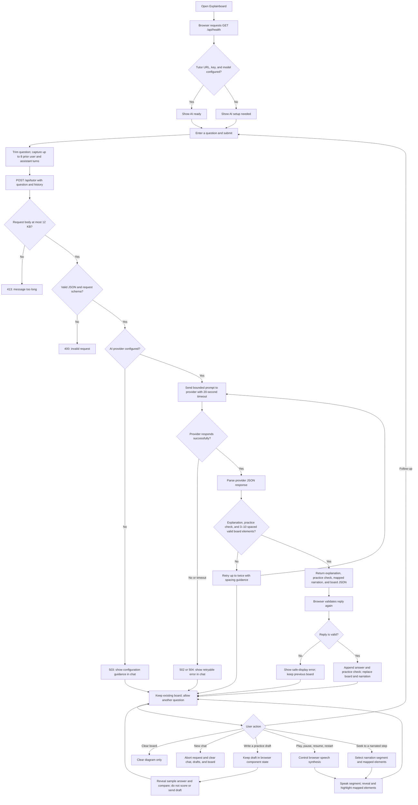

# Explainboard — End-to-End Guide

Explainboard is a visual study companion for self-directed secondary, university, and adult learners exploring unfamiliar ideas across subjects. It addresses a small learning problem: a learner may read an explanation without knowing whether they formed a useful mental model. The intended loop is **ask → explain → see → hear → retrieve**: a configured language model returns an explanation, a structured diagram, narration segments mapped to diagram elements, and one low-stakes practice question with a sample answer. The learner can draft a response locally and reveal the sample answer to compare; the app does not grade the draft.

The product deliberately stays focused on one learner and one idea at a time. It does not claim that a generated diagram is measured evidence, that the practice answer is definitive, or that a model can verify mastery.

## Product and engineering decisions

- **A focused learner loop over a broad classroom product.** One person can ask a follow-up immediately; accounts, courses, and saved notebooks are outside this prototype’s scope.
- **Ungraded retrieval over model scoring.** A learner can think or draft before revealing a sample answer. The draft stays in the browser, and the app avoids presenting an unverified model judgment as a score.
- **Browser speech instead of a separate TTS service.** Narration is text returned by the tutor and is spoken with the Web Speech API. The app makes no separate TTS request. Playback controls synchronize segments with mapped board elements; seek moves by segment because browser speech synthesis does not expose a reliable audio timeline.
- **Structured drawings over generated markup.** The model proposes bounded diagram data; shared validation and fixed SVG primitives keep layout and rendering under application control.
- **Live AI with explicit setup over a fake fallback.** Missing provider configuration is visible and actionable; the app does not disguise scripted responses as live tutoring.

## 1. Start the project

### Requirements

- Node.js 20.9 or newer
- npm
- An OpenAI-compatible chat-completions provider for live AI responses

### Install and run locally

From the project directory:

```powershell
npm ci
npm run dev
```

Open [http://localhost:3000](http://localhost:3000). `npm ci` installs the exact dependency versions recorded in `package-lock.json`.

### Configure the AI provider

Copy `.env.example` to `.env.local` and fill in the server-side settings:

```env
TUTOR_API_URL=https://your-provider.example/v1/chat/completions
TUTOR_API_KEY=your-server-side-key
TUTOR_MODEL=your-model-name
TUTOR_REASONING_EFFORT=none
TUTOR_USE_JSON_SCHEMA=true
```

`TUTOR_REASONING_EFFORT` and `TUTOR_USE_JSON_SCHEMA` are optional. Set them only if the provider/model supports these controls. `none` disables reasoning for supported models that otherwise use the entire output token limit for reasoning; `TUTOR_USE_JSON_SCHEMA=true` requests strict structured output. Restart the dev server after changing environment variables. Never add the API key to a `NEXT_PUBLIC_` variable or commit a real `.env.local` file. If any of the three required settings is missing, the UI shows “AI setup needed” and a question request receives HTTP 503 with setup guidance; there is no scripted answer fallback.

### Run a production build

```powershell
npm run build
npm run start
```

Set the same environment variables in the production host before starting the server.

## 2. End-to-end flow diagram



## 3. Application lifecycle

1. **Page and readiness.** The Next.js page renders the chat and whiteboard. The browser calls `GET /api/health`; the route reports whether all three tutor settings exist. This is a configuration indicator, not a provider connectivity test.
2. **Question composition.** The textarea accepts up to 1,200 characters. Enter submits, Shift+Enter inserts a newline, and composition events (for example IME input) are not treated as submit. Empty/whitespace-only questions are ignored.
3. **Context selection.** The browser takes up to the last eight prior user and assistant explanation messages. Error messages and practice drafts are excluded. Conversation state stays in React memory for the current tab and is not saved to local storage.
4. **Request validation.** `POST /api/tutor` checks the request body is at most 12,000 characters, parses JSON, checks a non-empty question of at most 1,200 characters, and validates up to eight history items with supported roles and bounded content. It returns 400 for malformed/invalid input and 413 for an oversized body.
5. **Provider call.** The server checks `TUTOR_API_URL`, `TUTOR_API_KEY`, and `TUTOR_MODEL`. If configured, it sends the system prompt, the selected prior turns, and the latest question to the OpenAI-compatible chat-completions endpoint. If `TUTOR_REASONING_EFFORT` is set to a supported value, that reasoning preference is included. If `TUTOR_USE_JSON_SCHEMA=true`, it requests strict structured output; otherwise it requests a JSON object. The call has a 20-second timeout. The API key is sent only from the server.
6. **Model output validation.** The endpoint expects JSON in `choices[0].message.content`, with a `message`, a `practice` object (`question` and `answer`), a `narration` array, and a `board` object. The board requires a title and 3–10 elements. Narration contains 3–10 bounded text segments; each segment maps zero-based `elementIndices` into `board.elements`, and every board element must be covered. Supported primitives are `text`, `box`, `circle`, `line`, `arrow`, and `freeform`; positions, path point count, dimensions, text, label lengths, and tones are bounded. Freeform paths are arrays of 2–24 numeric points and may be open strokes or closed outlines. Practice text is length-bounded. Text elements are centered and wrapped to short lines. Text, boxes, and circles may not overlap; the diagram must span at least 55% of both board dimensions; connectors have no inline labels. If the reply is invalid or the board is crowded/too compact, the server retries twice with more specific guidance, then fails safely with HTTP 502.
7. **Safe rendering, narration, and practice.** The browser validates the reply again. Freeform paths are assembled from validated numeric coordinates into smooth SVG curves. The whiteboard renders only fixed React SVG elements from validated data and a fixed palette; it never injects model-generated HTML, SVG markup, scripts, or styles. The browser’s `SpeechSynthesis` API speaks one narration segment at a time; the segment’s mapped elements appear and are highlighted as that utterance starts. Play, Pause, Resume, Restart, and a step slider control playback. If browser speech is unavailable, the voice buttons are disabled and the slider still previews mapped elements. The learner can also draft an answer in browser component state and reveal the model’s sample answer. The draft is neither scored nor sent to the tutor.
8. **State update and recovery.** On success, the explanation and practice check are appended to the conversation and the board/narration are replaced. During follow-up generation, the existing board and its playback remain available; a new valid answer replaces them. Request failure does not erase the existing result. “Clear” removes the drawing and cancels speech. “New chat” aborts an in-flight request and clears the conversation, board, practice checks, narration, and draft state.

## 4. Request and response contract

### Tutor request

```json
{
  "question": "How does photosynthesis work?",
  "history": [
    { "role": "user", "content": "Explain plant cells." },
    { "role": "assistant", "content": "Plant cells contain structures..." }
  ]
}
```

- `question`: non-empty after trimming; at most 1,200 characters.
- `history`: array of up to eight `{ role, content }` turns; role is `user` or `assistant`; each content string is at most 1,200 characters.
- Entire request body: at most 12,000 characters.

### Tutor response

```json
{
  "message": "Plants use light energy to turn water and carbon dioxide into sugar and oxygen.",
  "practice": {
    "question": "What does light energy help the plant make?",
    "answer": "It helps the plant make sugar from water and carbon dioxide."
  },
  "narration": [
    { "text": "Sunlight provides energy to the plant.", "elementIndices": [0] },
    { "text": "Water and carbon dioxide enter the process.", "elementIndices": [1] },
    { "text": "The plant makes sugar and releases oxygen.", "elementIndices": [2, 3] }
  ],
  "board": {
    "title": "Photosynthesis",
    "subtitle": "Light energy moves through a plant",
    "elements": [
      { "type": "text", "x": 12, "y": 18, "text": "Sunlight", "tone": "accent" },
      { "type": "box", "x": 12, "y": 36, "width": 24, "height": 18, "label": "Water + CO2" },
      { "type": "freeform", "points": [{ "x": 20, "y": 62 }, { "x": 35, "y": 42 }, { "x": 55, "y": 48 }, { "x": 78, "y": 30 }], "closed": false, "tone": "accent" },
      { "type": "circle", "x": 72, "y": 70, "radius": 10, "label": "Sugar + O2" }
    ]
  }
}
```

The sample is a shape illustration of the contract, not an offline response supplied by the app. Actual requests require a configured provider. Narration `elementIndices` are zero-based indexes into the board’s `elements`; every board element must appear in at least one step. Coordinates are percentage-like values from 3 to 97. Geometry, narration mappings, and text limits are checked in `src/lib/whiteboard.ts`. Freeform `points` are data only—not SVG path strings—and `closed` controls whether the final point connects to the first.

### Error behavior

| Status | Meaning | User-facing behavior |
|---|---|---|
| 400 | Malformed JSON or invalid question/history | Request rejected with an explanatory error |
| 413 | Request exceeds the body limit | Ask user to shorten the question |
| 502 | Provider failure or invalid model output | Retryable tutor error |
| 503 | Required provider settings are missing | Setup instructions appear in chat |
| 504 | Provider exceeded the 20-second timeout | Timeout message appears in chat |

## 5. Code map

| File | Responsibility |
|---|---|
| `src/app/page.tsx` | Chat UI, readiness status, conversation and narration state, client-only practice drafts, request lifecycle, reset and clear actions |
| `src/app/api/health/route.ts` | Non-secret provider configuration status |
| `src/app/api/tutor/route.ts` | Request limits, schema checks, provider request, timeout, model response parsing |
| `src/lib/whiteboard.ts` | Shared types and whiteboard/tutor reply validators |
| `src/lib/whiteboard.test.ts` | Unit tests for valid and invalid diagram shapes, bounds, and reply schema |
| `src/components/whiteboard.tsx` | Accessible SVG renderer, synchronized browser speech, and playback/seek controls |
| `src/app/globals.css` | Minimalist responsive layout, chat, whiteboard, and narration controls |
| `src/app/layout.tsx` | App metadata and root HTML layout |
| `.env.example` | Names of optional server-only provider settings |

## 6. Verification from a clean checkout

Install exactly from the lock file and run the complete configured checks:

```powershell
npm ci
npm run lint
npm test
npx tsc --noEmit
npm run build
```

There is a Vitest unit suite for diagram validation. This project does not currently have an automated browser E2E test runner. For a manual end-to-end pass, start the app with `npm run dev`, then verify:

1. The page loads, the health badge settles to “AI ready” or “AI setup needed,” and the empty chat/whiteboard are visible. The narration panel is also visible with playback disabled until an answer is ready.
2. With no provider credentials, submit a question and confirm setup guidance appears without a fake answer.
3. With valid provider credentials, ask a question and confirm the answer, diagram, practice check, and mapped narration appear.
4. Play narration and confirm mapped elements reveal/highlight in step order; pause, resume, seek to another step, and restart.
5. Write a practice draft, reveal the sample answer, and confirm the draft is not sent or scored.
6. Ask a follow-up; confirm the previous diagram remains during loading and on error, and valid output replaces it.
7. Clear the board, then start a new chat; confirm speech is canceled and each action has the documented scope.
8. Check keyboard behavior (Enter, Shift+Enter, IME composition) and responsive layouts at narrow and desktop widths.
9. In a browser without `SpeechSynthesis`, confirm voice buttons are unavailable and the step slider still previews mapped elements.
10. Confirm malformed JSON returns 400, an oversized body returns 413, and an unconfigured valid question returns 503.

## 7. Privacy, security, and limitations

- No accounts, server-side learner profiles, or persistent browser conversation storage are implemented.
- When a provider is configured, the current question and up to eight previous user/assistant turns are sent to that provider. Avoid sensitive personal information.
- Practice drafts remain in browser component state and are not sent to the provider. The generated sample answer is model output, not a verified answer key; no correctness score is presented.
- Narration text is generated by the configured model; the app makes no separate TTS request. Browser/operating-system voice processing, availability, and pronunciation follow that platform’s behavior. Seek selects a narration step, not an arbitrary time within an utterance.
- The health endpoint exposes only a boolean configuration state; it does not return the key or endpoint.
- Diagram rendering is constrained to fixed SVG primitives, including model-generated open and closed freeform paths; uploaded images, user-operated freehand input, pan/zoom, and executable model markup are not supported.
- No production rate limiter is implemented. Add provider-aware abuse controls before exposing a paid endpoint publicly.
- Model explanations, diagrams, and sample answers may be inaccurate. Explainboard is an educational aid, not an authoritative source.
